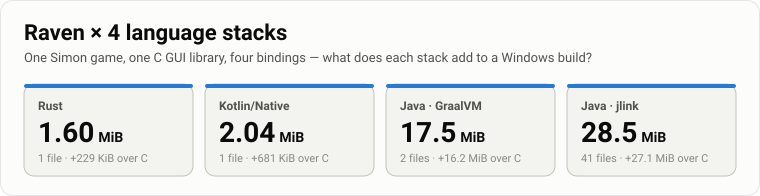
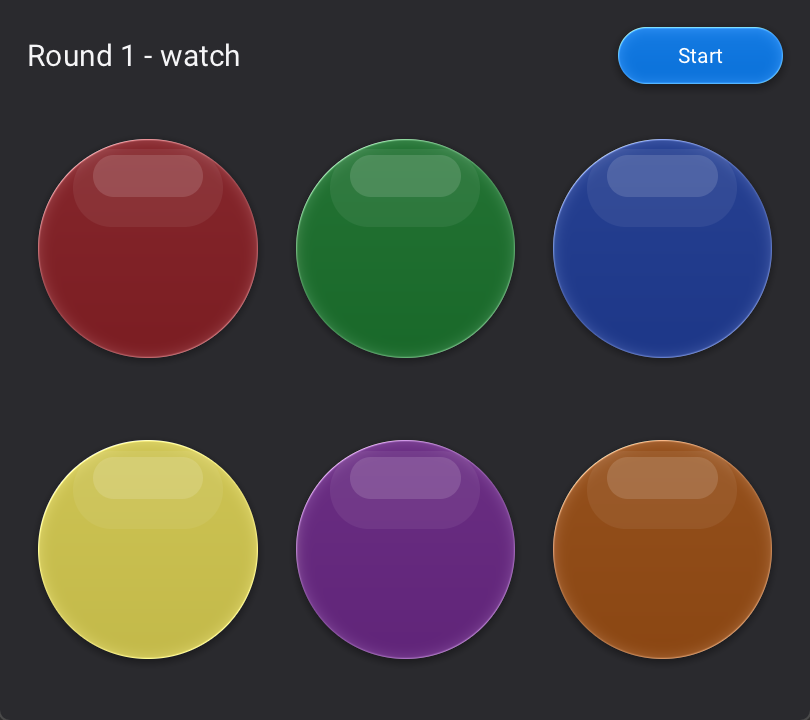
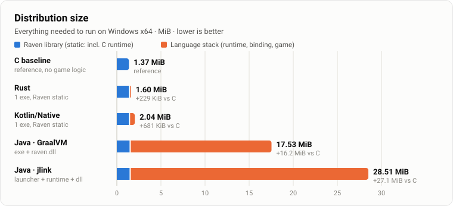
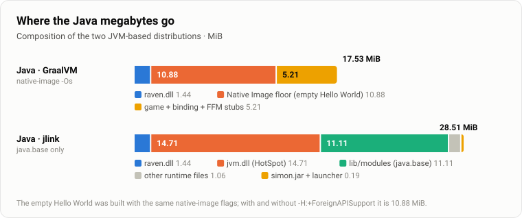
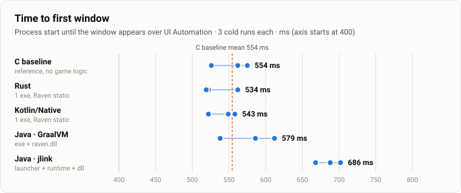
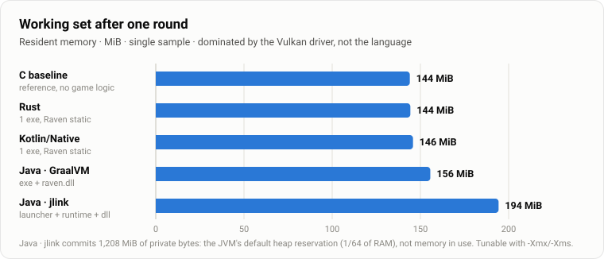
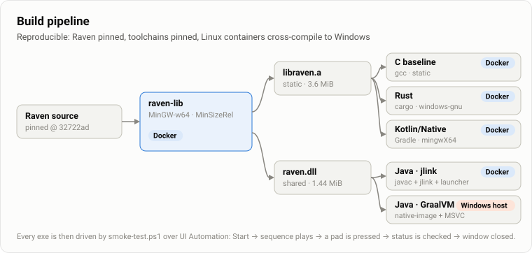

<div align="center">



<br>

**How much does a language stack add to a native GUI app?**<br>
One small game, one C GUI library — [Raven](https://github.com/oscar-soirey/Raven) — and four ways to drive it:
**Rust**, **Java (jlink)**, **Java (GraalVM native-image)** and **Kotlin/Native**,<br>
each squeezed into the smallest Windows x64 distribution that still runs.



</div>

---

## Contents

- [Key findings](#key-findings)
- [The contenders](#the-contenders)
- [Results](#results) — [size](#distribution-size) · [composition](#where-the-java-megabytes-go) · [startup](#time-to-first-window) · [memory](#memory) · [full table](#full-results)
- [Methodology](#methodology)
- [Build it yourself](#build-it-yourself)
- [Notes on the bindings](#notes-on-the-bindings)
- [Can the GraalVM build get smaller?](#can-the-graalvm-build-get-smaller)
- [Limitations](#limitations)
- [Repository layout](#repository-layout)

## Key findings

> [!NOTE]
> All sizes are the **complete folder you would ship** — nothing has to be installed besides Windows 10+ and a Vulkan-capable GPU driver.

1. **Raven itself costs ~1.4 MiB** and depends on nothing but Windows system DLLs. `vulkan-1.dll` ships with every GPU driver and is loaded at run time.
2. **Rust adds just 229 KiB** on top of a plain C build — one self-contained `.exe` of **1.60 MiB**.
3. **Kotlin/Native adds 681 KiB** (runtime, GC, collections) — **2.04 MiB**, also a single `.exe`, cross-compiled from Linux without trouble.
4. **GraalVM native-image lands at 17.5 MiB**, but **10.9 MiB of that is the floor**: an empty *Hello World* built with the same flags is already that big. The game, the binding and its FFM stubs account for 5.2 MiB.
5. **A trimmed jlink runtime is 28.5 MiB** — 14.7 MiB `jvm.dll` plus 11.1 MiB of `java.base` classes — and starts ~130 ms slower than the C baseline.
6. **Startup and memory are dominated by Vulkan, not by the language**: every variant shows its window after 0.5–0.7 s; the four native builds hold 144–156 MiB, the C baseline included, the JVM 194 MiB.

## The contenders

| Variant | Toolchain | Raven binding | Raven linked | Ships as |
|---|---|---|---|---|
| **C baseline** *(reference)* | MinGW-w64 GCC, `-Os` | the C headers | static | `simon-c.exe` — window only, no game logic |
| **Rust** | Rust 1.91, `x86_64-pc-windows-gnu`, `opt-level="z"`, LTO, `panic=abort` | official crate (`bindings/rust`) | static | `simon-rust.exe` |
| **Kotlin/Native** | Kotlin 2.2.21, `mingwX64`, release binary | generated by `cinterop` from `Raven.h` *(Raven has no Kotlin binding)* | static | `simon-kotlin.exe` |
| **Java · GraalVM** | GraalVM CE 25.0.1, `native-image -Os --gc=serial`, FFM enabled | official `raven.R` (Foreign Function & Memory API) | `raven.dll` | `simon-graal.exe` + `raven.dll` |
| **Java · jlink** | Temurin 25.0.1, jlink (`java.base` only, `zip-9`) + 16 KiB native launcher | official `raven.R` (FFM, no JNI) | `raven.dll` | launcher + `runtime/` + `simon.jar` + `raven.dll` |

All four games share **the same XML user interface and the same game logic** — a small state machine driven by one-shot Raven timers, an xorshift32 random generator, six pads that light up, a status label and a *Start* button — so the size differences come from the stacks, not from the apps.

**The look** is Raven's own *RavenGlassDark* theme, set in the XML alone (`Theme="RavenGlassDark"`), so no binding needs extra code: each pad is a square glass button, which Raven draws as a round capsule with a lit rim, refraction and a soft drop shadow; a two-layer, click-through highlight on top makes it read as a glossy plastic bubble. Pads are tinted with `Rwidget_set_color` and get brighter when lit; the springy press animation and the glow of touched glass come with the theme.

Raven is pinned to commit [`32722ad`](https://github.com/oscar-soirey/Raven/commit/32722ad0678b126b2629934882a53452e60dccec) and built `MinSizeRel` with everything a small game does not need switched off: web pages, `stb_image`, SVG, examples, tools and tests.

## Results

### Distribution size



The two native-compiled languages stay within the noise of the C reference. Both Java variants are an order of magnitude larger — with very different reasons.

### Where the Java megabytes go



- **GraalVM** — `native-image` already keeps only reachable code (closed-world analysis), so modules such as AWT or Swing never end up in the image. What remains is the Substrate VM runtime plus a pre-initialised image heap: **10.88 MiB for an empty program**, identical with and without `-H:+ForeignAPISupport`. The game adds 5.2 MiB, mostly `java.lang.invoke` machinery for the FFM downcalls and upcalls.
- **jlink** — the runtime contains only `java.base`. Launchers, header files, man pages, debug attributes, the UCRT forwarder DLLs, `msvcp140.dll`, `jli.dll`, `jvm.lib`, `cacerts` and the public-suffix list are all removed. The application itself is just **0.19 MiB**.

### Time to first window



Rust, Kotlin/Native and GraalVM stay within the run-to-run spread of C; the floor of ~0.5 s is Vulkan instance and device creation plus Raven's first frame. Only the JIT-based JVM is measurably slower, by roughly **130 ms**.

### Memory



The four native builds sit within 12 MiB of each other (144–156 MiB), the C baseline included, so most of this figure is the Vulkan driver and Raven, not the language; HotSpot adds about 50 MiB. The numbers are single samples and vary by a few MiB between runs.

### Full results

| Variant | Files | Size | vs. C | Startup (3 runs) | Mean | Working set | Private bytes |
|---|---:|---:|---:|---|---:|---:|---:|
| C baseline | 1 | **1,406 KiB** | — | 562 · 526 · 575 ms | 554 ms | 144 MiB | 158 MiB |
| Rust | 1 | **1,635 KiB** | +229 KiB | 522 · 519 · 562 ms | 534 ms | 144 MiB | 158 MiB |
| Kotlin/Native | 1 | **2,086 KiB** | +681 KiB | 522 · 549 · 558 ms | 543 ms | 146 MiB | 161 MiB |
| Java · GraalVM | 2 | **17,956 KiB** | +16.2 MiB | 612 · 538 · 586 ms | 579 ms | 156 MiB | 179 MiB |
| Java · jlink | 41 | **29,198 KiB** | +27.1 MiB | 668 · 702 · 688 ms | 686 ms | 194 MiB | 1,208 MiB ¹ |

<sub>¹ The JVM commits its default initial heap (1/64 of physical RAM) up front — reserved, not used. `-Xms`/`-Xmx` in the launcher would bring it down.</sub>

<details>
<summary><b>Size details per artifact</b></summary>

| Artifact | Bytes |
|---|---:|
| `libraven.a` (static library) | 3,769,692 |
| `raven.dll` | 1,515,008 |
| `simon-c.exe` | 1,439,232 |
| `simon-rust.exe` | 1,673,728 |
| `simon-kotlin.exe` | 2,136,064 |
| `simon-graal.exe` | 16,871,424 |
| GraalVM *Hello World* (same flags) | 11,411,456 |
| jlink `runtime/bin/server/jvm.dll` | 15,423,656 |
| jlink `runtime/lib/modules` | 11,649,531 |
| jlink other runtime files (38) | 1,112,784 |
| `simon.jar` | 181,197 |
| `simon-java.exe` (launcher) | 16,384 |

</details>

## Methodology

| | |
|---|---|
| **Machine** | AMD Ryzen 9 7950X3D, 64 GB RAM, NVIDIA GeForce RTX 4070 Ti SUPER (driver 32.0.16.1088) |
| **OS** | Windows 11 Pro, build 26100 |
| **Build host** | Docker Desktop 29.5.2 (Linux containers); GraalVM on the Windows host with Visual Studio 2022 |
| **Size** | sum of all files in the distribution folder (`dist/`), 1 KiB = 1,024 bytes |
| **Startup** | `smoke-test.ps1`: wall-clock time from `Start-Process` until the window is reachable over UI Automation, polled every 20 ms; three runs per variant |
| **Memory** | working set and private bytes of the process after one played round |
| **Correctness** | every build is played automatically over UI Automation: press *Start* → wait for the sequence → read *“your turn”* → press a pad → read *“Correct!”* or *“Wrong!”* → close the window → expect exit code 0 |

Raven exposes its widgets to UI Automation, which is what makes the black-box test possible without touching the code of the games.

## Build it yourself



**Requirements:** Docker Desktop with Linux containers. For the GraalVM variant additionally the *Desktop development with C++* workload of Visual Studio 2022 — GraalVM itself is downloaded by the script.

```powershell
pwsh build-all.ps1          # build every variant from scratch, then run the smoke tests
pwsh build-all.ps1 -NoTest  # build only
```

Or one at a time:

```powershell
docker build -t raven-mingw raven-lib                      # Raven: libraven.a + raven.dll (needed by all)
docker build --output type=local,dest=rust/dist rust       # likewise: baseline-c, java, kotlin-native
pwsh java-graal/build.ps1                                  # GraalVM native-image (Windows host)
pwsh smoke-test.ps1 rust/dist/simon-rust.exe               # play it over UI Automation
```

**Why GraalVM is not built in Docker:** `native-image` cannot cross-compile, and a Windows executable needs Windows and MSVC. Rather than switching Docker to Windows containers, `java-graal/build.ps1` downloads a pinned GraalVM CE into `java-graal/.tools/` (no global install) and uses the installed Visual Studio. The FFM metadata it needs — 9 downcall and 2 upcall signatures plus 2 reflectively looked-up methods — was recorded with the tracing agent (`build.ps1 -Trace`) and lives in `java-graal/config/reachability-metadata.json`.

**Regenerating the figures:** the numbers are in [`docs/results.json`](docs/results.json); `node docs/generate-charts.mjs` re-renders every SVG in `docs/img/` (no dependencies), and `pwsh docs/capture-screenshot.ps1` retakes the screenshot.

## Notes on the bindings

<details open>
<summary><b>Rust</b> — the official crate, one fix needed</summary>

- In static mode (`RAVEN_STATIC=1`), the crate links too few system libraries: `uuid`, `oleaut32`, `advapi32` and `winhttp` are missing. [`rust/build.rs`](rust/build.rs) adds them, as `link-arg`s so that they come after `libraven.a` on the linker line.
- The crate wraps the raw API with a few helpers (`action_bind` takes closures, `window_from_xml` and `widget_find` take `&str`); everything else is `unsafe` C calls.

</details>

<details open>
<summary><b>Java</b> — the official FFM binding, works on JVM and native-image alike</summary>

- `raven.R` is one generated class over the Foreign Function & Memory API: no JNI, no C glue to compile. It binds each function lazily, which is why native-image needs only the 9 signatures the game actually uses.
- The binding creates one upcall stub per callback **object** and never frees it. The game therefore uses a single timer callback and passes the event in `user_data` instead of creating a lambda per timer.
- Since JDK 24 the Windows JDK builds ship without `jmods` (JEP 493). jlink takes them from Adoptium's separate *jmods* package; the Linux `jlink` assembles the Windows runtime from them.
- The launcher ([`java/launcher/launcher.c`](java/launcher/launcher.c), 16 KiB) loads `jvm.dll` and starts the VM in-process through the JNI invocation API, so `java.exe`, `javaw.exe` and `jli.dll` are not needed.

</details>

<details open>
<summary><b>Kotlin/Native</b> — no binding needed, cinterop reads <code>Raven.h</code></summary>

- A short [`raven.def`](kotlin-native/src/nativeInterop/cinterop/raven.def) turns the C headers into a Kotlin API; `const char*` parameters accept `String` directly. Callbacks are `staticCFunction`s, so they cannot capture state — the game keeps its state in top-level properties and passes the pad index in `user_data`.
- Cross-compiling `mingwX64` from Linux works out of the box. The only snag: Kotlin/Native's bundled MinGW sysroot lacks the UI Automation GUIDs, so `raven-lib` also exports Debian's MinGW `libuuid.a` as `libravenuuid.a`.

</details>

## Can the GraalVM build get smaller?

Leaving out unused modules does not help: native-image already includes only reachable code, and its build report shows nothing from AWT or Swing (the largest non-`java.base` contributions are `java.logging` with 68 KiB and the Windows crypto provider with 21 KiB). Untested options that could shave off more:

| Option | Expected effect | Trade-off |
|---|---|---|
| Compress the exe with UPX | roughly half the file size | unpacks at start-up, no RAM saving, antivirus false positives |
| `--gc=epsilon` | slightly smaller | memory is never reclaimed |
| Avoid convenience APIs (`String.formatted`, …) | a few hundred KiB | less idiomatic code |
| `@CEntryPoint` / JNI instead of FFM | part of the 5.2 MiB | gives up the official binding |

Realistically the floor stays around 11–12 MiB plus `raven.dll` — the image always carries Substrate VM and its heap snapshot.

## Limitations

- **One machine, one GPU.** Startup and memory are dominated by the Vulkan driver and the glass renderer; other GPUs and drivers will shift the absolute numbers for every variant alike.
- **Few samples.** Startup is three cold runs and memory a single sample per variant — enough to separate the JVM from the rest, not for fine-grained ranking.
- **The C baseline has no game logic.** Its size is "Raven + C runtime"; the language-stack overhead of the other variants includes their ~200 lines of game.
- **Static vs. shared Raven.** The Java variants load `raven.dll` (1.44 MiB) because FFM looks symbols up in a library; the others link `libraven.a`, which `--gc-sections` trims slightly (1.37 MiB including the C runtime).

## Repository layout

```
raven-lib/        Dockerfile + MinGW toolchain file → image "raven-mingw" (libraven.a, raven.dll, headers, bindings)
baseline-c/       reference: the window in plain C
rust/             Cargo project + Dockerfile
java/             Simon.java, JNI-invocation launcher, Dockerfile (jlink)
java-graal/       build.ps1 (GraalVM native-image on Windows), FFM reachability metadata
kotlin-native/    Gradle project, cinterop .def, Dockerfile
docs/             results.json, chart generator, figures, screenshot script
build-all.ps1     builds everything and runs the smoke tests
smoke-test.ps1    plays a build over UI Automation and reports timing and memory
```

<div align="center"><sub>Built and measured on 2026-11-08 · Raven 0.2.2 @ <code>32722ad</code> · Rust 1.91 · Kotlin 2.2.21 · Temurin 25.0.1 · GraalVM CE 25.0.1</sub></div>
